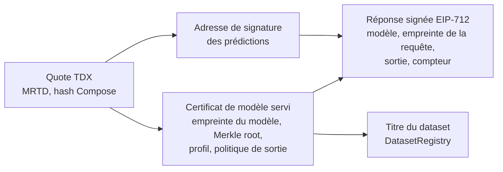

# Politique de sortie de l’enclave et API sur modèles privés

Note de décision du 19 octobre 2026. **Étude, pas une fonctionnalité** : rien n’est implémenté dans `src/` ni `contracts/`, aucune session Phala n’a été ouverte. Les chiffres viennent d’un prototype jetable hors du dépôt (annexe A), de mesures locales sur un Apple M2 et des mesures publiées dans la PR #111 (arbres boostés) ; la mesure réelle sur la CVM reste à faire. Les points tranchés par Noé le 19 octobre sont repris dans [D-27](DECISIONS.md#d-27--politique-de-sortie-unique-et-api-sur-modèles-privés) et marqués **Décidé** ci-dessous ; le reste est proposé.

Cette note rouvre en partie la décision du 14 octobre sur les nouveaux modèles (notes d’expériences de la branche `exp/agent-experience-lending`, non fusionnées dans `staging`), qui écartait tout modèle à servir depuis l’enclave (M07 type Kev, M08, M10). Elle ne la remplace pas : elle décrit à quelles conditions un service deviendrait acceptable. Les renvois aux « notes d’expériences » ci-dessous désignent ces documents.

## Partie 1 — API sur modèles privés

### 1.1 Ce que l’API protège, et ce qu’elle ne protège pas

Le modèle reste scellé dans la CVM ; l’acheteur, ou un agent, envoie des lignes et ne reçoit que des réponses. Le prototype mesure ce que valent ces réponses pour un attaquant, sur une logistique à 23 variables (le cas du crédit Taïwan), 20 tirages, 19 % de décisions positives :

| Sortie de l’API | Requêtes | Résultat pour l’attaquant |
|---|---|---|
| Probabilité exacte | 24 (= d + 1) | Poids retrouvés à 10⁻¹⁵ près : copie exacte |
| Probabilité à 2 décimales | 24 / 48 | 91 % / 98,7 % d’accord sur les décisions |
| Probabilité à 1 décimale | 48 / 240 | 94 % / 97,8 % |
| Décision seule, 24 requêtes | 24 | 74 % d’accord équilibré, soit à peine mieux qu’une réponse constante (50 %) |
| Décision seule, attaquant actif | 240 / 480 | 98,7 % / 100 % |
| Décision seule, usage « normal » (ses propres clients) | 480 / 2 400 | 96,6 % / 99,3 % |

« Accord équilibré » = moyenne de l’accord sur les acceptés et sur les refusés du vrai modèle ; une réponse constante obtient 50 %. Détail et limites : annexe A.

Quatre conclusions :

1. **Renvoyer une probabilité, même arrondie, revient à livrer le modèle.** L’arrondi ne multiplie le coût que par deux à dix.
2. **La décision seule tient contre 24 requêtes, pas contre 240.** Un attaquant actif reconstruit la frontière avec environ 10 requêtes par variable (recherche dichotomique, Lowd & Meek 2005).
3. **Un usage normal suffit à cloner une logistique.** Un client honnête qui score environ 2 400 de ses propres dossiers obtient, sans rien chercher, un clone d’accord 99,3 %. **Les quotas et le prix doivent donc partir de ce constat** : tout client qui a payé quelques milliers d’appels doit être considéré comme détenteur du modèle.
4. **Pour une linéaire ou une logistique, l’API ne protège donc pas la fonction de décision.** Elle protège les poids exacts, la calibration et surtout **les lignes d’entraînement** contre les attaques qui exigent le fichier du modèle (comptes par feuille, seuils extrêmes, canaris répétés). Or la logistique et la linéaire livrées « ne fuient rien de mesurable » selon les notes d’expériences. **L’API n’a d’intérêt que pour les modèles dont la livraison est dangereuse** : M10 (liste secrète), M07 (mémorisation des records répétés), arbres moins bridés.

Les arbres n’ont pas été attaqués par requêtes ici : leur format dépend de la PR #111, non fusionnée. À refaire sur son format final.

### 1.2 Sortie et quotas

- **Décidé — sortie : décision seule** (`0/1` ou `GO/NO_GO`), avec la version du modèle et une signature. Jamais de probabilité, même arrondie.
- **Décidé — modèle livré ou servi : Sirius décide par profil en v1.** Linéaire et logistique sont livrées ; les profils jugés risqués ne sont que servis. Le choix laissé au fournisseur viendra plus tard.
- **Quotas par entité KYB et par modèle**, pas par wallet : un même acteur peut multiplier les wallets, pas les attestations KYB (D-6). Compteur durable dans le registre SQLite du runner, réservé avant le calcul.
- **Prix calé sur le clonage** : environ 2 400 appels d’usage normal (250 à 500 pour un attaquant actif, d = 23) donnent un clone. Le prix cumulé de ce volume doit valoir au moins le modèle livré équivalent ; au-delà, l’acheteur paie un service, pas un secret. Le quota sert surtout contre le sondage ciblé (tester une à une les adresses de la liste secrète de M10).
- **Journal des appels** (empreinte de la requête, client, horodatage), sans les valeurs, pour détecter les rafales près de la frontière.

### 1.3 Facturation et rémunération du fournisseur

L’escrow v7 facture **un entraînement** : un devis fixe, un dépôt, un règlement unique. Son `consumedCompute` ne sert qu’à la retenue plafonnée en cas d’échec (`ESCROW-V7.md`) ; il ne peut pas compter des appels sans changer le contrat.

**Proposition, non décidée, hors du périmètre d’implémentation actuel : des crédits prépayés.** Noé penche pour cette option plutôt qu’un abonnement.

1. L’acheteur dépose on-chain un montant de crédits pour un modèle servi, valable jusqu’à une date.
2. L’enclave tient le solde et débite chaque appel servi dans son registre durable, avant le calcul ; un appel refusé (quota, politique de sortie) n’est pas débité.
3. Périodiquement, le runner signe un reçu cumulatif d’usage ; le contrat crédite le fournisseur et Sirius au prorata (retraits pull-only, `withdrawFor`) et rembourse le reliquat à échéance.

| Option | Avantages | Inconvénients |
|---|---|---|
| **Crédits prépayés** (proposée) | Même logique que v7 et D-23 : tout est réservé avant la dépense, aucun supplément ; règlement groupé, donc peu de frais. | Nouveau contrat ou extension de v7, donc revue Solidity. Perte du registre d’enclave avant reçu = usage non prouvable (même risque que le checkpoint runner d’aujourd’hui). |
| Abonnement mensuel | Simple à vendre. | Rémunération du fournisseur à définir, encaissement récurrent absent du protocole. |
| Paiement par appel on-chain | Transparence. | Frais et latence absurdes pour un score. |

Rémunération du fournisseur, dans cette proposition : **une part fixe par appel réellement servi**, cumulée dans le reçu périodique.

### 1.4 Prouver qu’une réponse vient du modèle X entraîné sur le dataset Y

On ne peut pas produire une quote TDX par réponse. La chaîne proposée réutilise celle de `/phala/attestation` :



1. À la fin de l’entraînement, le runner scelle le modèle et émet un **certificat de modèle servi** : une quote dont les données utilisateur engagent l’empreinte du modèle, le Merkle root du dataset, le profil d’entraînement, le profil de sortie et **l’adresse de signature des prédictions**.
2. Cette clé est dérivée de la clé maître sous un contexte propre (`prediction:sign:v1`), distinct du compte de règlement (D-5). Elle ne sort jamais de l’enclave.
3. Chaque réponse est signée en EIP-712 : identifiant du modèle, empreinte de la requête, sortie, compteur, client.
4. Un vérificateur contrôle la signature, retrouve l’adresse dans le certificat, la quote (MRTD, hash Compose, enclave non retirée) puis le titre on-chain du dataset.

Ce que la chaîne prouve : « le code attesté a calculé cette réponse avec le modèle d’empreinte H, entraîné par lui sur le dataset de racine R ». Ce qu’elle ne prouve pas : la qualité du dataset, ni que la requête de l’acheteur est sincère.

### 1.5 Coût et débit d’une CVM tdx.small

Référence mesurée : sur la CVM staging, 30 000 lignes × 23 variables s’entraînent en environ 5 s (linéaire) et 5,74 s (logistique) de bout en bout, sans 503 ni arrêt du worker (18 octobre, PR #105).

Coût CPU par appel, mesuré localement (Apple M2, un processus Node, TLS 1.3) :

| Étape | Coût M2 |
|---|---|
| Logistique, 23 variables | 38 ns |
| Arbres, 100 × profondeur 2 / 300 × profondeur 3 | 1,2 µs / 6,4 µs |
| Lecture JSON et validation des 23 colonnes | 1,8 µs |
| Compteur durable SQLite (réglages du registre runner), une transaction par appel | 51 µs (disque macOS) |
| Signature secp256k1 (OpenSSL) / EIP-712 avec viem | 203 µs / 300 µs |
| Poignée de main TLS complète | ≈ 420 µs |

Le modèle ne coûte rien ; **la signature et le TLS font le débit.** Estimation pour un vCPU, avec un facteur de ralentissement de 2 à 8 par rapport au M2 (hypothèse ; la borne haute vient du rapport entre 5,74 s sur la CVM, réseau et IPFS compris, et 0,76 s pour 30 000 lignes × 23 variables dans le worker local, journal du 17 octobre) :

| Scénario serveur | CPU par appel (M2) | Appels/s estimés sur 1 vCPU |
|---|---|---|
| Connexion réutilisée, réponse non signée | 22 µs | 5 700 à 23 000 |
| Connexion réutilisée, réponse signée (OpenSSL) | 275 µs | 450 à 1 800 |
| Connexion réutilisée, réponse signée (viem) | ≈ 320 µs | 390 à 1 550 |
| Nouvelle connexion TLS par appel, réponse signée | 681 µs | 180 à 730 |

À ajouter : le disque chiffré de la CVM (fsync du compteur, inconnu, à grouper si besoin), le passage éventuel par Next, et surtout **le partage du vCPU avec les entraînements** : une logistique de 30 000 lignes occupe le processeur près de 6 s, pendant lesquelles les réponses attendent. Avec un vCPU, servir et entraîner en même temps impose une priorité ou une seconde CVM.

Coût fixe : environ 0,061 USD/h (0,058 de calcul + 0,0028 de disque), soit **44 USD/mois si la CVM reste allumée**. La capacité ne limite pas ; le coût fixe, si. À 0,001 USD de marge Sirius par appel, il faut 44 000 appels par mois pour couvrir la seule machine.

**Décidé — pas de CVM allumée en continu pour l’instant.** Le prototype et l’API ne vivent que pendant les sessions manuelles de D-25. Un fonctionnement continu demandera une décision séparée, appuyée sur le business plan.

Modèle type Kev (langage) : GPU obligatoire, donc une CVM GPU confidentielle d’un autre ordre de prix. Hors de ce chiffrage.

### 1.6 Découpage du prototype `POST /predict`, à lancer après la fusion des arbres boostés

Pas dans ce chantier : il toucherait `handler.ts` et `core.ts` pendant que le chantier GBDT (#111) change le moteur et le format des modèles. Découpage prévu, en staging seulement, actif uniquement pendant une session manuelle ouverte (D-25), derrière une variable désactivée par défaut (`SIRIUS_PREDICT_ENABLED`) :

| Élément | Emplacement | Contenu |
|---|---|---|
| Opération runner | `src/lib/runner/capability.ts`, `src/runner/handler.ts` | Nouvelles opérations `predict` (portée `{ modelId }`) et, en option, un mode `served` de `run-training` qui scelle au lieu de livrer. Même chemin que les autres : capacité HMAC, grant wallet, anti-rejeu. |
| Stockage scellé | nouveau `src/lib/tee/served-models.ts` | Modèle passé par la politique de sortie, chiffré sous `deriveKey(master, "model:served:v1:<modelId>")`, stocké sur le volume du runner (jamais livré, aucune clé remise). Cache déchiffré en mémoire, borné. |
| Politique de sortie | `src/lib/tee/egress-policy.ts` (partie 2) | `gatePrediction` : décision seule, refus si quota atteint. |
| Compteur | registre budgétaire SQLite (`src/lib/runner/budget-ledger.ts`) | Table `prediction_usage(client, model, jour, appels)`, incrément conditionnel atomique avant calcul. |
| Signature | `src/lib/evm/runner-account.ts` ou voisin | Compte dérivé `prediction:sign:v1`, signature EIP-712 de la réponse. |
| Accès | `src/app/api/models/[id]/predict/route.ts` | Proxy Next, limité en débit, session wallet existante. L’accès direct d’un agent en RA-TLS viendra ensuite. |
| Tests | à côté des fichiers touchés | Décision seule (aucun champ probabilité), quota durable après redémarrage, modèle inconnu, refus de la politique, signature vérifiable, et l’attaque de l’annexe A : 24 décisions donnent moins de 80 % d’accord équilibré. |

## Partie 2 — Fuites, nettoyage et politique de sortie

### 2.1 Deux sens de « fuite »

| | Fuite de qualité | Fuite de confidentialité |
|---|---|---|
| Question | Le dataset contient-il la réponse ou des défauts ? | Le modèle livré ou les réponses permettent-ils de retrouver des lignes ? |
| Exemples | Colonne qui recopie la cible ou corrélée à plus de 0,99 ; constantes ; manquants ; doublons | Mémorisation de lignes répétées ; feuilles minuscules ; écart entraînement/test ; appartenance |
| Qui doit savoir | Le **fournisseur**, à l’import | Personne : l’**enclave** décide |
| Réponse | Rapport de qualité, sans modifier les données | Livrer, dégrader ou refuser |

Elles ne se traitent pas au même endroit : un rapport de qualité détaillé montré à l’acheteur deviendrait lui-même une fuite. Le fournisseur voit le détail de son propre fichier ; l’acheteur ne voit qu’un résumé grossier (par exemple « 3 colonnes ignorées »).

Constat dans le code actuel : `numericColumns` (`src/lib/tee/train.ts:33`) **écarte silencieusement toute colonne contenant une seule valeur manquante ou non numérique**. Le rapport de qualité doit au minimum l’afficher.

### 2.2 Nettoyage : préparer dans le modèle, pas dans le fichier

**Décidé — le dataset n’est jamais modifié ; la préparation fait partie du modèle.** Raisons :

- son Merkle root, calculé sur le CSV en clair (`core.ts:110`), est ancré dans le titre on-chain et revérifié avant chaque entraînement (`core.ts:146`) ;
- c’est exactement ce qui est vendu et ce que les reçus engagent ; un fichier « nettoyé » serait un autre produit, sans preuve qu’il dérive de l’original.

La préparation devient donc **une étape du modèle**, recalculée dans l’enclave à chaque entraînement et livrée avec lui : imputation (médiane, plus un indicateur « manquant »), normalisation, encodage borné des catégories. Gain mesuré le 15 octobre (document de cadrage du week-end) : logistique de 0,719 à 0,773 d’AUC sur Taïwan et de 0,666 à 0,797 sur GMSC. Ses statistiques (médianes, moyennes) sont des agrégats sur au moins 100 lignes, arrondis par la politique de sortie.

Ce changement modifie le profil d’entraînement, donc son hash ancré on-chain (D-11) : il n’entre que dans une **nouvelle version de profil** (par exemple logistique v2), jamais dans linéaire et logistique v1. Le grouper avec le prochain ajout de profil évite une migration de registre supplémentaire.

Sans risque à l’import : **signaler** tout (constantes, manquants, décompte des doublons, colonne suspecte de recopier la cible, déséquilibre de classes) et **refuser** ce qui empêche tout entraînement (déjà fait). **Dans l’enclave, à l’entraînement** : ignorer les colonnes constantes, plafonner l’influence de chaque ligne distincte plutôt que retirer les doublons (ils peuvent être légitimes, et un record répété reste la fuite la plus forte : 22 % contre 13 % dans la #111, jusqu’à 54 à 99 % pour des arbres moins bridés selon les notes d’expériences), imputer. Rien de cela ne change le Merkle root.

### 2.3 Une politique de sortie unique

Aujourd’hui, `gateModel` (`src/lib/tee/output-gate.ts`) arrondit à 6 chiffres significatifs et plafonne la taille. Pour linéaire et logistique v1, le nombre de lignes `n` sort exact et les métriques sont calculées sur les lignes d’entraînement elles-mêmes. Les arbres de la PR #111 mettent déjà une ligne sur cinq de côté et livrent des métriques held-out (`heldOutAuc`, etc.) plus `trainAuc`.

**Décidé — métriques sur tranche de test et `n` arrondi seulement pour les nouveaux profils ou nouvelles versions de profil.** Le format livré de linéaire et logistique v1 ne change pas.

Signal mesuré par la PR #111 (canaris, 3 graines × 20, indicatif) : une ligne atypique présente **5 fois** est restituée par les arbres dans **22 %** des cas, contre **13 %** pour des lignes jamais vues ; présente une fois, 8 % contre 5 % ; la logistique reste à 5 % contre 2 %. Les doublons sont la fuite qui résiste au bridage. Pistes reprises de cette PR :

1. **Rapport de qualité** : décompte des lignes strictement identiques (lignes concernées, multiplicité maximale), montré au fournisseur, sans révéler les lignes.
2. **Plafond d’influence par ligne distincte, dans l’enclave** : chaque ligne distincte pèse au plus *k* (par exemple 2) dans les gradients et les comptes de feuilles. Les doublons légitimes restent, sans retirer de données ni changer le Merkle root ; coût d’un hachage par ligne.
3. **Seuil sur `trainAuc − heldOutAuc`** dans la politique de sortie.

**Décidé — une politique de sortie unique**, qui englobe `gateModel` et vaut pour les modèles livrés comme pour les réponses d’API :

```ts
type EgressAction = "deliver" | "degrade" | "refuse";

/** Produit par l’entraînement ; ne sort jamais de l’enclave. */
interface TrainingDiagnostics {
  rows: number;
  distinctRows: number;
  maxDuplicateCount: number;
  influenceCapApplied: number;  // k effectif par ligne distincte
  parameters: number;          // poids, ou feuilles × arbres
  trainLoss: number;
  holdoutLoss: number;
  holdoutRows: number;
  trainAuc?: number;           // classification
  heldOutAuc?: number;
  membershipAuc: number;       // pertes des lignes d’entraînement contre la tranche de test
  minLeafRows?: number;        // fourni par chaque famille d’arbres
}

/** Versionné et engagé avec le profil d’entraînement. */
interface EgressProfile {
  id: string;
  version: string;
  minRowsPerParameter: number;
  minLeafRows?: number;
  maxInfluencePerDistinctRow: number;
  maxGeneralizationGap?: number; // écart de perte relatif ; inactif tant que non calibré (annexe B)
  maxAucGap?: number;           // trainAuc − heldOutAuc ; inactif tant que non calibré (annexe B)
  maxMembershipAuc: number;
  significantDigits: number;
  rowCountRounding: number;     // n publié arrondi à ce pas
  maxArtifactBytes: number;
  prediction: {
    output: "decision";
    maxCallsPerClientPerDay: number;
    maxCallsPerClientTotal: number;
  };
}

interface EgressCheck {
  rule: keyof EgressProfile | "quota";
  passed: boolean;
  measured?: number;
  limit?: number;
}

type EgressVerdict<T> =
  | { action: "deliver" | "degrade"; output: T; checks: EgressCheck[] }
  | { action: "refuse"; checks: EgressCheck[] };

interface EgressPolicy<Model, Answer> {
  gateModel(model: Model, diagnostics: TrainingDiagnostics, profile: EgressProfile): EgressVerdict<Model>;
  gatePrediction(raw: Answer, usage: { client: string; today: number; total: number }, profile: EgressProfile): EgressVerdict<Answer>;
}

/** Chaque famille de modèles décrit sa structure sans exposer de comptes au livrable. */
interface ModelInspector<Model> {
  parameters(model: Model): number;
  minLeafRows?(model: Model): number;
  stripCounts(model: Model): Model;
}
```

Règles déterministes et action par défaut. **Les valeurs sont provisoires et volontairement prudentes** ; elles seront calibrées sur Taïwan, Give Me Some Credit et `credit-risk`, avec les mesures en annexe B.

| Règle | Mesure | Valeur provisoire | Action si dépassée |
|---|---|---|---|
| Lignes par paramètre | `rows / parameters` | ≥ 10 (existant) | Refuser |
| Taille minimale des feuilles | plus petite feuille réelle, pas le réglage demandé | ≥ 1 000 lignes (#111) | Refuser |
| Influence par ligne distincte | poids d’une ligne répétée | k ≤ 2 (provisoire) | Toujours appliqué dans l’enclave |
| Doublons | lignes répétées, multiplicité maximale | — | **Signaler au fournisseur** dans le rapport de qualité ; aucun refus automatique (doublons légitimes, comme dans la #111) |
| Écart d’AUC | `trainAuc − heldOutAuc` | **Non applicable tant que l’annexe B ne l’a pas calibré** | Refuser, une fois activé. Condition d’activation : les jeux d’exemple de la #111 passent. Le test de la #111 ne borne l’écart que dans un sens (`trainAuc ≥ heldOutAuc − 0,02`) ; un plafond à 0,02 pourrait refuser les arbres sur leurs propres exemples. |
| Écart de perte | `holdoutLoss − trainLoss`, relatif | **Non applicable tant que l’annexe B ne l’a pas calibré** | Dégrader (régularisation plus forte) puis refuser, une fois activé. Condition d’activation : les jeux d’exemple de la #111 passent. |
| Appartenance | AUC des pertes entraînement contre test | ≤ 0,55 (provisoire) | Refuser |
| Arrondi | chiffres significatifs ; `n` arrondi et métriques held-out pour les nouveaux profils seulement | 6 chiffres ; `n` à la centaine (provisoire) | Toujours appliqué |
| Taille maximale | octets du livrable | 256 Kio (existant) | Refuser |
| Quota (API) | appels par client et par modèle | à fixer avec le prix (§1.2) | Refuser l’appel |

Le détail des contrôles va au fournisseur ; l’acheteur reçoit un refus générique. Un refus après calcul est un échec au sens de D-23 : dataset et compute non consommé remboursés. Les contrôles qui ne dépendent que du fichier (lignes par paramètre) sont donc faits **à l’import**, avant tout devis ; le décompte des doublons y est seulement affiché.

Place dans le code : la politique remplace l’appel direct à `gateModel` dans `sealTrainedModel` (`core.ts:160`) ; `gateModel` en devient la partie « arrondi, structure et taille ». L’entraînement renvoie `{ model, diagnostics }` à travers le worker (`train-worker.ts`). Le futur `/predict` appelle `gatePrediction`. Ces fichiers changent avec la PR #111 : seules les interfaces ci-dessus sont proposées.

**Mesurable en moins de 15 s sur un vCPU**, pour 30 000 lignes : la tranche de test suit la #111 (une ligne sur cinq selon l’index de ligne, `index % 5 === 4`, jamais utilisée pour l’entraînement ; tout changement de méthode impose une nouvelle version de profil) et l’entraînement sur les 80 % restants coûte moins que l’entraînement complet ; l’évaluation, les doublons (une empreinte par ligne), l’AUC d’appartenance par les pertes et l’inspection des feuilles sont linéaires et se comptent en dizaines de millisecondes. **Hors budget** : attaques par modèles fantômes (LiRA), canaris injectés, extraction adaptative ; elles restent des audits hors ligne. Une absence de fuite mesurée ne prouve pas l’absence de fuite (M07 et M10).

### 2.4 Plan par étapes

| Étape | Contenu | Risque | Dépend de |
|---|---|---|---|
| E1 | Rapport de qualité à l’import, dans le navigateur, sans modifier le fichier : cible qui change, colonnes écartées et leurs cellules manquantes, constantes, doublons, colonne qui recopie la cible, déséquilibre | Faible | **Livré** (PR E1, après la #111) |
| E2 | Politique de sortie v1 : verdict, plafond d’influence par ligne distincte, AUC d’appartenance ; seuil `trainAuc − heldOutAuc` seulement une fois calibré ; métriques held-out et `n` arrondi pour les nouveaux profils uniquement | Moyen | Fusion #111 (`train.ts`, `output-gate.ts`) ; seuils provisoires puis calibration (annexe B) |
| E3 | Préparation intégrée au modèle (imputation, normalisation, encodage) | Moyen (nouvelle version de profil) | Profil des arbres ou version suivante |
| E4 | Prototype `/predict` en staging (§1.6), pendant les sessions manuelles | Moyen | E2, fusion #111 |
| E5 | Crédits prépayés et rémunération par appel | Élevé (contrat) | Décision commerciale, revue Solidity |
| — | CVM allumée en continu | Coût fixe | Décision séparée, business plan |
| — | Modèle type Kev servi | Élevé (GPU) | Hors périmètre |

E1 est l’incrément le plus utile et le moins risqué : il ne change ni ce qui sort de l’enclave ni les contrats.

**E1, choix de la v1 : rapport dans le navigateur seulement.** Il est calculé sur le fichier en clair avant chiffrement et n’est ni envoyé, ni stocké, ni publié. Le recalculer dans l’enclave obligerait à le renvoyer par Next et, pour qu’il serve à l’acheteur, à le publier ; or `Dataset.metrics` est public (marketplace, page de preuve) et `publicDatasetMetrics` (`src/lib/sirius/metrics.ts`) n’en garde volontairement que `rowCount` et `columnCount`. Un décompte de doublons ou une liste de colonnes défectueuses renseignerait sur les données. Le fournisseur peut modifier ce rapport dans son navigateur : il n’a aucune valeur de preuve, la validation qui fait foi reste celle du runner. E2 calculera les doublons dans l’enclave comme diagnostic interne, jamais publié. Seuils provisoires : \|r\| ≥ 0,98 ou identité (cible, 1 − cible) pour la fuite de la cible, classe minoritaire < 10 %. La règle numérique est celle de l’enclave (`isNumericCell`, `src/lib/sirius/metrics.ts`) : écriture décimale seulement ; une cellule faite d’espaces compte comme vide et une valeur préfixée 0x/0b/0o n’est pas un nombre (audit ROB-01, ROB-02 : `Number()` les lisait 0 ou en base 16/2/8). Messages « à vérifier », aucun refus ajouté par le rapport ; les refus de forme (parseur strict, cible presque numérique, EXA-03) viennent du contrôle du fichier, identique à celui de l’enclave. Sur `/phala`, le même rapport porte sur la colonne à prédire choisie (fichier réordonné comme celui envoyé à l’enclave) ; une cible non numérique y est annoncée comme refus de `csvWithTargetLast`, qui applique désormais la règle numérique de l’enclave (borne 10¹²).

## Décisions

**Décidé le 19 octobre 2026 (D-27)** :

1. Sortie de l’API : **décision seule**, jamais de probabilité, même arrondie.
2. **Une politique de sortie unique dans l’enclave**, pour les modèles livrés et les réponses d’API.
3. **Le dataset n’est jamais modifié** ; la préparation fait partie du modèle.
4. **API réservée aux modèles dangereux à livrer** ; en v1, Sirius décide par profil (linéaire et logistique livrées).

Également tranché, hors D-27 : seuils provisoires puis calibrés ; métriques held-out et `n` arrondi seulement pour les nouveaux profils ou versions ; pas de CVM continue, API pendant les sessions manuelles.

**Recommandé, non décidé** : quotas par entité KYB et par modèle, prix calé sur le volume de clonage ; crédits prépayés ; certificat de modèle servi puis réponses signées par une clé dérivée dédiée ; commencer par E1 après la fusion de la #111.

## Questions ouvertes

1. Quand et comment laisser au fournisseur le choix entre modèle livré et servi seulement (D-11) ?
2. Valeurs définitives des seuils, après calibration (annexe B).
3. Quotas et prix par appel : niveaux exacts, à partir des ~2 400 appels de clonage par usage normal.
4. Crédits prépayés : nouveau contrat ou extension de v7, période de règlement, part du fournisseur.
5. Fonctionnement continu de la CVM : décision séparée avec le business plan.
6. Plafond d’influence *k* : à mesurer avec le banc canaris de la #111 avant de l’imposer.

## Annexe A — Prototype jetable

Emplacement : `~/sirius-private/egress-proto/` (hors du dépôt, Node 26, sans dépendance). `lib.mjs` et `attack.mjs` sont reproduits ci-dessous. Les autres scripts : `bench.mjs` (coûts en processus), `https-bench.mjs` (serveur HTTPS TLS 1.3, CPU serveur par appel, poignées de main sans reprise de session), `quota-bench.mjs` (compteur SQLite, mêmes réglages que le registre runner), `viem-sign.mjs` (signature EIP-712 avec le viem du dépôt, en lecture seule).

**Méthode.** Population synthétique : 23 variables standardisées, corrélation commune 0,3. Victime : logistique aux poids tirés au hasard, constante −1,4, 19 % de décisions positives au seuil 0,5. L’attaquant possède une population de référence de même distribution (même modèle de menace que les notes d’expériences). Mesures sur 10 000 lignes de test, 20 tirages, médiane et 10e centile.

- (a) Probabilité exacte : 24 lignes, résolution de `logit(p) = w·x + b`.
- (c) Probabilité arrondie : moindres carrés sur les réponses non saturées.
- (b) Décision seule, passif : l’attaquant réentraîne une logistique sur ses requêtes. Actif : un point positif, puis recherche dichotomique de points de la frontière entre des négatifs et ce positif, puis ajustement du plan.

**Résultats complets** (`node attack.mjs 20`) :

```text
(a) Probabilité exacte, 24 requêtes : erreur relative des poids 4.8e-15 (max 2.3e-13), accord des décisions 100.0 %

(c) Probabilité arrondie : erreur relative des poids / accord équilibré des décisions
| Décimales | 24 | 48 | 96 | 240 | 480 | 960 |
| 4 | 0.3 % / 99.9 % | 0.1 % / 100.0 % | 0.0 % / 100.0 % | 0.0 % / 100.0 % | 0.0 % / 100.0 % | 0.0 % / 100.0 % |
| 3 | 3.0 % / 99.0 % | 0.5 % / 99.9 % | 0.3 % / 99.9 % | 0.2 % / 99.9 % | 0.2 % / 100.0 % | 0.1 % / 99.9 % |
| 2 | 19.9 % / 91.1 % | 3.3 % / 98.7 % | 2.4 % / 99.2 % | 1.5 % / 99.5 % | 1.0 % / 99.7 % | 0.7 % / 99.7 % |
| 1 | échec | 16.8 % / 94.2 % | 10.6 % / 96.8 % | 7.5 % / 97.8 % | 6.2 % / 98.5 % | 5.7 % / 98.7 % |

(b) Décision seule : accord équilibré [10e centile] (accord global)
| Requêtes | Passif (réentraînement) | Actif (frontière) |
| 24 | 74.2 % [59.7 %] (81.9 %) | impossible |
| 48 | 80.0 % [67.7 %] (85.7 %) | impossible |
| 96 | 85.8 % [79.8 %] (90.7 %) | 60.3 % [50.1 %] (66.1 %) |
| 120 | 88.8 % [83.9 %] (92.5 %) | 63.7 % [44.4 %] (72.7 %) |
| 160 | 91.4 % [83.1 %] (94.2 %) | 88.2 % [63.4 %] (92.2 %) |
| 240 | 94.2 % [89.2 %] (96.1 %) | 98.7 % [95.0 %] (99.4 %) |
| 480 | 96.6 % [93.5 %] (97.8 %) | 100.0 % [100.0 %] (100.0 %) |
| 960 | 98.1 % [96.7 %] (98.9 %) | 100.0 % [100.0 %] (100.0 %) |
| 2400 | 99.3 % [98.4 %] (99.5 %) | 100.0 % [100.0 %] (100.0 %) |
| 4800 | 99.5 % [99.4 %] (99.7 %) | 100.0 % [100.0 %] (100.0 %) |
| 9600 | 99.7 % [99.6 %] (99.9 %) | 100.0 % [100.0 %] (100.0 %) |
```

Une réponse constante « refuser » obtient 80,8 % d’accord global : l’accord global à 24 requêtes (81,9 %) n’apporte donc presque rien.

**Limites.** Données synthétiques gaussiennes ; l’effet de vraies variables de crédit (bornées, discrètes) sur ces budgets n’est pas mesuré. L’attaque active envoie des combinaisons de lignes réelles, que la validation des colonnes ne peut pas distinguer d’un vrai dossier. Les attaques ne sont pas optimales (l’arrondi peut être exploité plus finement), donc les budgets mesurés sont des majorants du coût d’un attaquant. Arbres non testés. Débit mesuré sur M2, pas sur la CVM.

<details>
<summary><code>lib.mjs</code></summary>

```js
// Outils numériques du prototype jetable : aucun import du dépôt Sirius.

export function rng(seed) {
  let s = seed >>> 0 || 1;
  const next = () => {
    s ^= s << 13; s >>>= 0;
    s ^= s >>> 17;
    s ^= s << 5; s >>>= 0;
    return s / 4294967296;
  };
  const normal = () => {
    let u = 0;
    while (u === 0) u = next();
    return Math.sqrt(-2 * Math.log(u)) * Math.cos(2 * Math.PI * next());
  };
  return { next, normal };
}

export const sigmoid = (z) => 1 / (1 + Math.exp(-z));
export const logit = (p) => Math.log(p / (1 - p));
export const dot = (w, x) => { let s = 0; for (let i = 0; i < x.length; i++) s += w[i] * x[i]; return s; };

// Population de type crédit : 23 variables standardisées, corrélation commune 0,3.
export function population(r, d, n, rho = 0.3) {
  const out = [];
  for (let k = 0; k < n; k++) {
    const g = r.normal();
    const x = new Array(d);
    for (let i = 0; i < d; i++) x[i] = Math.sqrt(1 - rho) * r.normal() + Math.sqrt(rho) * g;
    out.push(x);
  }
  return out;
}

// Modèle victime : logistique à d variables, environ 19 % de décisions positives au seuil 0,5.
export function victim(r, d) {
  const w = Array.from({ length: d }, () => 0.35 * r.normal());
  return { w, b: -1.4 };
}

// Résout A x = y (Gauss, pivot partiel). A carrée, modifiée en place.
export function solve(A, y) {
  const n = A.length;
  const M = A.map((row, i) => [...row, y[i]]);
  for (let c = 0; c < n; c++) {
    let p = c;
    for (let r2 = c + 1; r2 < n; r2++) if (Math.abs(M[r2][c]) > Math.abs(M[p][c])) p = r2;
    [M[c], M[p]] = [M[p], M[c]];
    for (let r2 = c + 1; r2 < n; r2++) {
      const f = M[r2][c] / M[c][c];
      for (let k = c; k <= n; k++) M[r2][k] -= f * M[c][k];
    }
  }
  const x = new Array(n).fill(0);
  for (let c = n - 1; c >= 0; c--) {
    let s = M[c][n];
    for (let k = c + 1; k < n; k++) s -= M[c][k] * x[k];
    x[c] = s / M[c][c];
  }
  return x;
}

// Moindres carrés (équations normales + petite crête) sur [x, 1].
export function leastSquares(X, y, ridge = 1e-9) {
  const p = X[0].length + 1;
  const A = Array.from({ length: p }, () => new Array(p).fill(0));
  const v = new Array(p).fill(0);
  for (let k = 0; k < X.length; k++) {
    const row = [...X[k], 1];
    for (let i = 0; i < p; i++) {
      v[i] += row[i] * y[k];
      for (let j = 0; j < p; j++) A[i][j] += row[i] * row[j];
    }
  }
  for (let i = 0; i < p; i++) A[i][i] += ridge;
  const sol = solve(A, v);
  return { w: sol.slice(0, -1), b: sol[p - 1] };
}

// Logistique par Newton (IRLS) avec crête : sert à l'attaquant « passif ».
export function fitLogistic(X, y, ridge = 1e-2, iters = 25) {
  const d = X[0].length;
  let w = new Array(d + 1).fill(0);
  for (let it = 0; it < iters; it++) {
    const H = Array.from({ length: d + 1 }, () => new Array(d + 1).fill(0));
    const g = new Array(d + 1).fill(0);
    for (let k = 0; k < X.length; k++) {
      const row = [...X[k], 1];
      const p = sigmoid(dot(w, row));
      const s = p * (1 - p);
      for (let i = 0; i <= d; i++) {
        g[i] += (p - y[k]) * row[i];
        for (let j = 0; j <= d; j++) H[i][j] += s * row[i] * row[j];
      }
    }
    for (let i = 0; i <= d; i++) { g[i] += ridge * w[i]; H[i][i] += ridge; }
    const step = solve(H, g);
    w = w.map((v, i) => v - step[i]);
  }
  return { w: w.slice(0, -1), b: w[d] };
}

export function median(a) { const s = [...a].sort((x, y) => x - y); return s[Math.floor(s.length / 2)]; }
export function quantile(a, q) { const s = [...a].sort((x, y) => x - y); return s[Math.floor(q * (s.length - 1))]; }
```

</details>

<details>
<summary><code>attack.mjs</code></summary>

```js
// Extraction d'une logistique à 23 variables servie par API (Tramèr et al. 2016 ; Lowd & Meek 2005).
// Usage : node attack.mjs [graines=20]
import { rng, sigmoid, logit, dot, population, victim, solve, leastSquares, fitLogistic, median, quantile } from "./lib.mjs";

const D = 23;
const SEEDS = Number(process.argv[2] ?? 20);
const TEST = 10_000;

function oracle(model, mode) {
  let calls = 0;
  const q = (x) => {
    calls++;
    const p = sigmoid(dot(model.w, x) + model.b);
    if (mode === "proba") return p;
    if (mode === "decision") return p >= 0.5 ? 1 : 0;
    return Number(p.toFixed(mode)); // probabilité arrondie à `mode` décimales
  };
  return { q, calls: () => calls };
}

// Accord global et accord équilibré (moyenne des accords sur les acceptés et sur les refusés
// du modèle victime) : une réponse constante obtient l'accord global du taux de base, mais 50 % équilibré.
function agreement(model, est, test) {
  let ok = 0, pos = 0, okPos = 0;
  for (const x of test) {
    const truth = dot(model.w, x) + model.b >= 0;
    const same = truth === (dot(est.w, x) + est.b >= 0);
    ok += same ? 1 : 0;
    if (truth) { pos++; okPos += same ? 1 : 0; }
  }
  const neg = test.length - pos;
  return { all: ok / test.length, bal: (okPos / pos + (ok - okPos) / neg) / 2, posRate: pos / test.length };
}

function relErr(model, est) {
  let num = 0, den = 0;
  for (let i = 0; i < D; i++) { num += (model.w[i] - est.w[i]) ** 2; den += model.w[i] ** 2; }
  num += (model.b - est.b) ** 2; den += model.b ** 2;
  return Math.sqrt(num / den);
}

// (a) Probabilité exacte : d+1 équations linéaires logit(p) = w·x + b.
function attackExact(model, r) {
  const o = oracle(model, "proba");
  const X = population(r, D, D + 1);
  const A = X.map((x) => [...x, 1]);
  const y = X.map((x) => logit(o.q(x)));
  const sol = solve(A, y);
  return { est: { w: sol.slice(0, D), b: sol[D] }, calls: o.calls() };
}

// (c) Probabilité arrondie : moindres carrés sur les réponses non saturées.
function attackRounded(model, r, decimals, budget) {
  const o = oracle(model, decimals);
  const X = [], y = [];
  for (const x of population(r, D, budget)) {
    const p = o.q(x);
    if (p > 0 && p < 1) { X.push(x); y.push(logit(p)); }
  }
  if (X.length <= D) return null;
  return { est: leastSquares(X, y, 1e-6), calls: o.calls() };
}

// (b1) Décision seule, attaquant passif : interroge sa population de référence et ré-entraîne.
function attackPassive(model, r, budget) {
  const o = oracle(model, "decision");
  const X = population(r, D, budget);
  const y = X.map((x) => o.q(x));
  const pos = y.reduce((s, v) => s + v, 0);
  if (pos === 0 || pos === y.length) return { est: { w: new Array(D).fill(0), b: pos ? 1 : -1 }, calls: o.calls() };
  return { est: fitLogistic(X, y), calls: o.calls() };
}

// (b2) Décision seule, attaquant actif : recherche dichotomique de points sur la frontière, puis plan.
function attackActive(model, r, budget) {
  const o = oracle(model, "decision");
  const pool = population(r, D, 4 * budget);
  let xp = null, idx = 0;
  const negatives = [];
  while (!xp && idx < pool.length && o.calls() < budget) {
    const x = pool[idx++];
    if (o.q(x)) xp = x; else negatives.push(x);
  }
  if (!xp) return null;
  const m = Math.max(D + 1, Math.ceil((budget - o.calls()) / 31));
  const k = Math.floor((budget - o.calls()) / m) - 1;
  if (k < 1) return null;
  const boundary = [];
  while (boundary.length < m && o.calls() + k + 1 <= budget) {
    let xn = negatives.pop();
    if (!xn) { xn = pool[idx++]; if (!xn || o.q(xn)) continue; }
    let lo = 0, hi = 1; // lo côté négatif, hi côté positif
    for (let s = 0; s < k; s++) {
      const t = (lo + hi) / 2;
      const x = xn.map((v, i) => v + t * (xp[i] - v));
      if (o.q(x)) hi = t; else lo = t;
    }
    const t = (lo + hi) / 2;
    boundary.push(xn.map((v, i) => v + t * (xp[i] - v)));
  }
  if (boundary.length < D) return null;
  const fit = leastSquares(boundary.map((x) => x.slice(0, D)), new Array(boundary.length).fill(1), 1e-9);
  // Les points vérifient w·x + c = 1 pour toute la famille (α·w*, 1 + α·b*) ; la crête choisit
  // l'élément de norme minimale, α ≠ 0. Frontière estimée : w·x + (c - 1) = 0, orientée par xp.
  let est = { w: fit.w, b: fit.b - 1 };
  if (dot(est.w, xp) + est.b < 0) est = { w: est.w.map((v) => -v), b: -est.b };
  return { est, calls: o.calls() };
}

const exactErr = [], exactAgree = [], posRates = [];
const BUDGETS_ROUNDED = [24, 48, 96, 240, 480, 960];
const BUDGETS_DECISION = [24, 48, 96, 120, 160, 240, 480, 960, 2400, 4800, 9600];
const acc = new Map();
const push = (key, err, agree) => {
  const e = acc.get(key) ?? { err: [], all: [], bal: [] };
  if (err !== undefined) e.err.push(err);
  if (agree) { e.all.push(agree.all); e.bal.push(agree.bal); }
  acc.set(key, e);
};

for (let seed = 1; seed <= SEEDS; seed++) {
  const r = rng(1000 + seed);
  const model = victim(r, D);
  const test = population(r, D, TEST);
  const ex = attackExact(model, r);
  const exAgree = agreement(model, ex.est, test);
  exactErr.push(relErr(model, ex.est));
  exactAgree.push(exAgree.all);
  posRates.push(exAgree.posRate);
  for (const dec of [4, 3, 2, 1]) for (const b of BUDGETS_ROUNDED) {
    const res = attackRounded(model, r, dec, b);
    const key = `rounded:${dec}:${b}`;
    if (res) push(key, relErr(model, res.est), agreement(model, res.est, test));
    else push(key);
  }
  for (const b of BUDGETS_DECISION) {
    const pas = attackPassive(model, r, b);
    push(`passive:${b}`, undefined, agreement(model, pas.est, test));
    const act = attackActive(model, r, b);
    push(`active:${b}`, undefined, act ? agreement(model, act.est, test) : null);
  }
}

const pct = (v) => (100 * v).toFixed(1) + " %";
console.log(`Logistique d = ${D}, ${SEEDS} graines, population de test ${TEST}. Médiane [10e centile].`);
console.log(`Taux de décisions positives du modèle victime : ${pct(median(posRates))} (une réponse constante obtient ${pct(1 - median(posRates))} d'accord global, 50 % équilibré).\n`);
console.log(`(a) Probabilité exacte, ${D + 1} requêtes : erreur relative des poids ${median(exactErr).toExponential(1)} (max ${Math.max(...exactErr).toExponential(1)}), accord des décisions ${pct(median(exactAgree))}\n`);
console.log("(c) Probabilité arrondie : erreur relative des poids / accord équilibré des décisions");
console.log("| Décimales | " + BUDGETS_ROUNDED.join(" | ") + " |");
for (const dec of [4, 3, 2, 1]) {
  const cells = BUDGETS_ROUNDED.map((b) => {
    const e = acc.get(`rounded:${dec}:${b}`);
    if (e.err.length < SEEDS / 2) return "échec";
    return `${(100 * median(e.err)).toFixed(1)} % / ${pct(median(e.bal))}`;
  });
  console.log(`| ${dec} | ${cells.join(" | ")} |`);
}
console.log("\n(b) Décision seule : accord équilibré [10e centile] (accord global)");
console.log("| Requêtes | Passif (réentraînement) | Actif (frontière) |");
for (const b of BUDGETS_DECISION) {
  const fmt = (e) => (e.bal.length < SEEDS / 2 ? "impossible" : `${pct(median(e.bal))} [${pct(quantile(e.bal, 0.1))}] (${pct(median(e.all))})`);
  console.log(`| ${b} | ${fmt(acc.get(`passive:${b}`))} | ${fmt(acc.get(`active:${b}`))} |`);
}
```

</details>

**Mesures de débit brutes** (M2, Node 26, 8 s par scénario, trois processus clients, CPU du seul processus serveur) :

```text
| Connexion | Réponse signée | CPU serveur par appel | Appels par seconde de CPU | Poignées de main TLS |
| connexion réutilisée | non | 22 µs | 46 117 | 0 |
| connexion réutilisée | oui | 275 µs | 3 631 | 0 |
| nouvelle connexion TLS par appel | non | 445 µs | 2 245 | 15 498 (0 reprise) |
| nouvelle connexion TLS par appel | oui | 681 µs | 1 468 | 10 887 (0 reprise) |
Signature EIP-712 viem : 300 µs ; compteur SQLite WAL, synchronous FULL : 51 µs par transaction, 2,6 µs groupé par 100.
```

Références : F. Tramèr, F. Zhang, A. Juels, M. Reiter, T. Ristenpart, « Stealing Machine Learning Models via Prediction APIs », USENIX Security 2016. D. Lowd, C. Meek, « Adversarial Learning », KDD 2005.

## Annexe B — Calibration des seuils

Non réalisée à la date de cette note : les valeurs du §2.3 sont provisoires. Protocole prévu, sur Taïwan, Give Me Some Credit et l’exemple `credit-risk` de la #111, avec le découpage déterministe des arbres (une ligne sur cinq mise de côté) :

1. Relever, pour chaque profil, `trainAuc − heldOutAuc` (signé), l’écart de perte relatif et l’AUC d’appartenance par la perte sur le modèle normal, y compris sur les jeux d’exemple de la #111.
2. Rejouer le banc canaris de la #111 (lignes atypiques ×1 et ×5) avec et sans plafond d’influence *k* = 1, 2, 4, et mesurer l’effet sur l’AUC held-out.
3. Fixer chaque seuil juste au-dessus des valeurs des modèles normaux et sous celles des modèles qui restituent les canaris ; reporter ici les tableaux et la commande. Les seuils d’écart d’AUC et d’écart de perte ne s’activent que si tous les jeux d’exemple de la #111 passent.
